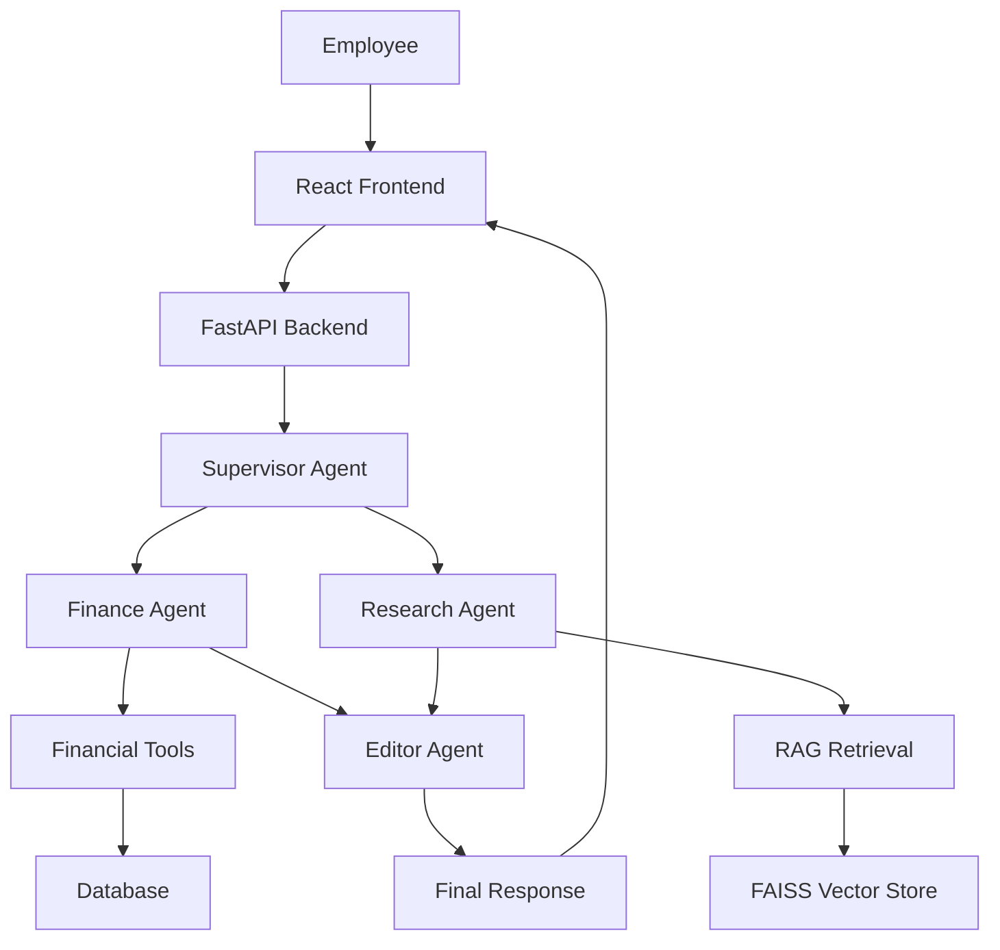

# FinAI — Multi-Agent Financial Assistant

An AI-powered financial assistant that helps employees analyze company financial reports and invoices through specialized AI agents. FinAI combines document intelligence, OCR, Retrieval-Augmented Generation (RAG), and multi-agent orchestration to simplify financial information retrieval and analysis.

## Overview

FinAI is designed as an internal financial intelligence assistant for organizations managing multiple companies' financial documents.

Employees can upload financial reports and invoices, then interact with the assistant using natural-language queries. A supervisor agent determines which specialized agent should handle each query and coordinates the response.

The system separates deterministic financial calculations from semantic document reasoning to provide more structured and reliable answers.

## Key Features

- **Multi-Agent Architecture:** Specialized Finance, Research, Editor, and Supervisor agents.
- **Financial Analysis:** Retrieve financial metrics, calculate revenue, expenses, outstanding amounts, and other financial summaries.
- **Document Intelligence:** Extract information from uploaded financial reports and invoices using OCR and document processing.
- **RAG-Based Retrieval:** Retrieve relevant information from indexed financial documents using semantic search.
- **Intelligent Query Routing:** Route questions to the appropriate agent based on the user's intent.
- **Invoice Tracking:** Retrieve invoice details and identify pending and overdue invoices.
- **Voice Interaction:** Interact with the financial assistant through voice input and spoken responses.
- **Multi-Company Support:** Work with financial information across multiple companies and uploaded documents.

## System Architecture



## Agent Responsibilities

| Agent | Responsibility |
|---|---|
| **Supervisor Agent** | Understands the user's query and determines the appropriate execution path. |
| **Finance Agent** | Handles financial calculations, invoice information, and structured financial queries. |
| **Research Agent** | Performs semantic retrieval and reasoning over uploaded financial documents. |
| **Editor Agent** | Combines and organizes agent outputs into a clear final response. |

### Query Routing

The Supervisor Agent can route queries through different execution paths:

- **Finance:** For numerical calculations and structured financial information.
- **Research:** For document-based questions and contextual reasoning.
- **Both:** When a query requires financial calculations as well as document research.

## Document Processing Pipeline

1. Upload financial reports and invoices.
2. Extract document content using document processing and OCR.
3. Process and split extracted content into manageable chunks.
4. Generate embeddings for semantic retrieval.
5. Store document representations in the FAISS vector store.
6. Retrieve relevant information when employees submit queries.

## Technology Stack

| Category | Technologies |
|---|---|
| Frontend | React, JavaScript, CSS, Vite |
| Backend | Python, FastAPI |
| Agent Orchestration | LangGraph |
| Language Models | Ollama, Qwen3 |
| RAG | Sentence Transformers, FAISS |
| Document Processing | OCR, PDF extraction |
| Database | SQLite, SQLAlchemy |
| Voice Interaction | LiveKit, Deepgram, ElevenLabs |
| Version Control | Git, GitHub |

## Project Structure

```text
FinAI/
│
├── agents/
│   ├── supervisor.py
│   ├── finance_agent.py
│   ├── research_agent.py
│   ├── editor_agent.py
│   ├── qwen.py
│   └── states.py
│
├── api/
│
├── backend/
│   ├── main.py
│   ├── document_extractor.py
│   └── reset_data.py
│
├── data/
│   ├── documents/
│   └── vector_store/
│
├── database/
│   ├── db.py
│   ├── models.py
│   └── seed.py
│
├── frontend/
│   ├── src/
│   ├── public/
│   └── package.json
│
├── rag/
│   ├── ingest.py
│   ├── document_manager.py
│   ├── vector_store.py
│   └── update_vector_store.py
│
├── tools/
│   ├── customer_tools.py
│   ├── financial_tools.py
│   └── transaction_tools.py
│
├── voice/
│   └── finance_voice.py
│
├── requirements.txt
├── package.json
└── README.md
```

## Installation and Setup

### Prerequisites

- Python 3.10+
- Node.js and npm
- Ollama
- Git

### 1. Clone the Repository

```bash
git clone https://github.com/IHardik-Gawde/FinAi-multi-agent-financial-assistant.git

cd FinAi-multi-agent-financial-assistant
```

### 2. Backend Setup

Create and activate a Python virtual environment:

```bash
python -m venv finance-ai
```

Windows:

```bash
finance-ai\Scripts\activate
```

Install Python dependencies:

```bash
pip install -r requirements.txt
```

### 3. Configure Environment Variables

Create a `.env` file in the appropriate project directory and configure the required API credentials.

Keep your credentials private. Never commit `.env` files to GitHub.

### 4. Configure Ollama

Install Ollama and pull the language model:

```bash
ollama pull qwen3:1.7b
```

Make sure the Ollama service is running before starting the application.

### 5. Frontend Setup

```bash
cd frontend
npm install
npm run dev
```

### 6. Start the Backend

From the project root, start the FastAPI application using the appropriate Uvicorn entry point configured in the project.

## Example Use Cases

Employees can ask questions such as:

- What is the total outstanding invoice amount for a company?
- Which invoices are overdue?
- Summarize the financial performance of a particular company.
- What are the major operating expenses mentioned in the financial report?
- Compare financial information across uploaded company reports.
- Identify missing or inconsistent information in an invoice.

## Design Principles

- **Separation of Responsibilities:** Financial calculations and document reasoning are handled by separate agents.
- **Intent-Based Routing:** Queries are directed to the appropriate agent rather than sending every request through the same workflow.
- **Document-Grounded Responses:** Research answers are based on retrieved financial documents.
- **Structured Tool Execution:** Financial operations use dedicated tools for accessing and processing structured information.

## Future Improvements

- Enhanced financial anomaly detection.
- Improved document extraction and validation.
- Advanced financial trend analysis.
- More robust multi-company reporting.
- Expanded voice interaction capabilities.
- Agent evaluation and performance benchmarking.

## Author

**Hardik Gawde**

GitHub: [@IHardik-Gawde](https://github.com/IHardik-Gawde)

---

*FinAI — Turning financial documents into actionable intelligence.*
